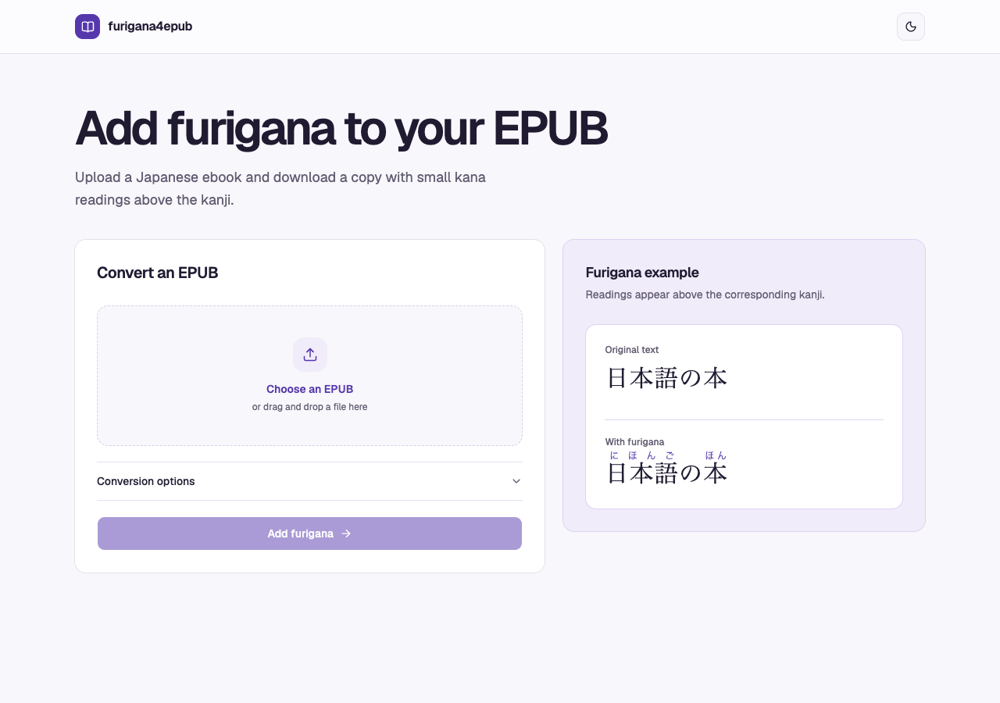

# furigana4epub

Add hiragana furigana to Japanese EPUB 3 books using Sudachi.

## Web usage

Open the [web converter](https://nohackjustnoobb.github.io/furigana4epub/), choose a Japanese EPUB, and click **Add furigana**. When conversion finishes, click **Download EPUB**.



## GUI usage

Launch the app and click **Update Dictionary** to download or refresh the shared dictionary and JLPT wordlists. Choose an EPUB and set your options. Click **Convert EPUB**, then choose where to save the converted book.

Under **Ignored wordlists**, check the shared wordlists you want to use, or click **Add wordlist files…** to select custom files. The converter skips adding furigana to words in the checked lists.

### Download from GitHub Releases

Open the [latest release](https://github.com/nohackjustnoobb/furigana4epub/releases/latest). Under **Assets**, choose the archive for your operating system and processor (`x64` or `arm64`). Extract the archive.

- **macOS**. Double-click the extracted `furigana4epub` executable in Finder. If macOS blocks the first launch, go to **System Settings → Privacy & Security**, scroll down to **Security**, click **Open Anyway**, and confirm the prompt ([Apple Support instructions](https://support.apple.com/en-us/102445)). After that, you can double-click it as usual. You can also run `./furigana4epub` from the extracted folder in Terminal.
- **Linux**. Run `./furigana4epub` from the extracted folder in your terminal.
- **Windows**. Open `furigana4epub.exe`.

### Run or build from source

Use Rust 1.98 or newer and install the [GPUI Kit prerequisites for your operating system](https://gpui-kit.com/docs/installation/#platform-requirements).

Run the GUI from the repository root.

```sh
cargo run --locked -p gui
```

To build the executable, run `cargo build --release --locked -p gui`. Find it at `target/release/gui` (`target/release/gui.exe` on Windows).

## CLI usage

Install the CLI from the repository root, then download the Sudachi Full V1 dictionary and convert a book.

```sh
cargo install --path cli --locked
furigana4epub update-dict
furigana4epub book.epub
```

To run the CLI directly from the repository root, use `cargo run`. Put CLI options and paths after `--`.

```sh
cargo run --locked -p cli -- update-dict
cargo run --locked -p cli -- book.epub
```

The CLI writes `book.furigana.epub` beside `book.epub`. Pass a second path to choose a different destination. The destination must be a new file.

```sh
furigana4epub --highlight-color '#2563eb' book.epub annotated.epub
```

After a successful conversion, the CLI prints the output path, elapsed time, and settings used.

Rerun `update-dict` to refresh the dictionary and JLPT wordlists. The CLI and GUI share the `furigana4epub` folder in your local user data directory.

Repeat `--ignore-wordlist` to skip furigana for words in any of the selected lists.

```sh
furigana4epub --ignore-wordlist jlpt/n1 --ignore-wordlist jlpt/n2 --ignore-wordlist ./my-words.txt book.epub
```

To remove the shared dictionary and JLPT wordlists, run `furigana4epub remove-dict`. From the repository root, you can also run `cargo run --locked -p cli -- remove-dict`.

### Options

| Option                     | Effect                                                                                               |
| -------------------------- | ---------------------------------------------------------------------------------------------------- |
| `--dictionary <PATH>`      | Use a local Sudachi V1 dictionary in place of the shared default.                                    |
| `--ignore-wordlist <LIST>` | Skip words from a shared or custom wordlist. Repeat to combine lists.                                |
| `--override-existing`      | Replace existing ruby when Sudachi can read its entire base. By default, existing ruby is preserved. |
| `--highlight-injected`     | Highlight the generated furigana in the default color, `#c2410c`.                                    |
| `--highlight-color <HEX>`  | Highlight the generated furigana in a CSS hex color such as `#2563eb`.                               |
| `--new-identifier`         | Generate a new primary EPUB identifier.                                                              |
| `--identifier <VALUE>`     | Set the primary EPUB identifier explicitly. Takes precedence over `--new-identifier`.                |
| `-h`, `--help`             | Show command-line help.                                                                              |

The original identifier is preserved by default. Changing it requires an EPUB without encrypted or obfuscated resources.

## API usage

| Request                   | Result                                                                                           |
| ------------------------- | ------------------------------------------------------------------------------------------------ |
| `POST /jobs`              | Create a job with `filename`, optional `size_bytes`, and optional `options`. Returns the job ID. |
| `PUT /jobs/{id}/wordlist` | Optionally upload one custom wordlist before uploading the EPUB.                                 |
| `PUT /jobs/{id}/upload`   | Upload the raw EPUB bytes and queue the job.                                                     |
| `GET /jobs/{id}`          | Poll for status. A `finished` job includes `download_url`.                                       |
| `GET /jobs/{id}/download` | Download the converted EPUB.                                                                     |
| `GET /wordlists`          | List the available wordlist IDs.                                                                 |

```sh
curl -fsS http://localhost:8080/jobs \
  -H 'Content-Type: application/json' \
  -d '{"filename":"book.epub","options":{"highlight_color":"#2563eb","ignore_wordlists":["jlpt/N1.txt"]}}'

# Set JOB_ID to the id from the response.
# Optional. Upload a UTF-8 text file with one word per line.
curl -fsS -T words.txt -H 'Content-Type: text/plain; charset=utf-8' \
  "http://localhost:8080/jobs/$JOB_ID/wordlist"
curl -fsS -T book.epub -H 'Content-Type: application/epub+zip' \
  "http://localhost:8080/jobs/$JOB_ID/upload"
# Repeat until the status is finished or failed.
curl -fsS "http://localhost:8080/jobs/$JOB_ID"
curl -fsS -o book.furigana.epub "http://localhost:8080/jobs/$JOB_ID/download"
```

Job options are `override_existing`, `highlight_injected`, `highlight_color`, `new_identifier`, `identifier`, and `ignore_wordlists`. Use IDs from `GET /wordlists` in `ignore_wordlists`. If provided, `size_bytes` must match the upload exactly.

An uploaded wordlist applies to that job alongside any installed lists selected in `ignore_wordlists`.

## Self-hosting

From the repository root, start the API with Docker Compose.

```sh
docker compose up --build -d
```

The API is available at `http://localhost:8080`. SQLite and EPUB files are stored in `data/`.

## Data sources and licenses

- Sudachi Full V1 dictionary by Works Applications. [SudachiDict repository](https://github.com/WorksApplications/SudachiDict) · [Apache License 2.0](https://github.com/WorksApplications/SudachiDict/blob/develop/LICENSE-2.0.txt) · [Third-party notices](https://github.com/WorksApplications/SudachiDict/blob/develop/LEGAL)
- JLPT vocabulary from Jamie Sinclair’s Open Anki JLPT Decks. [Open Anki JLPT Decks repository](https://github.com/jamsinclair/open-anki-jlpt-decks) · [MIT License](https://github.com/jamsinclair/open-anki-jlpt-decks/blob/main/LICENSE)
